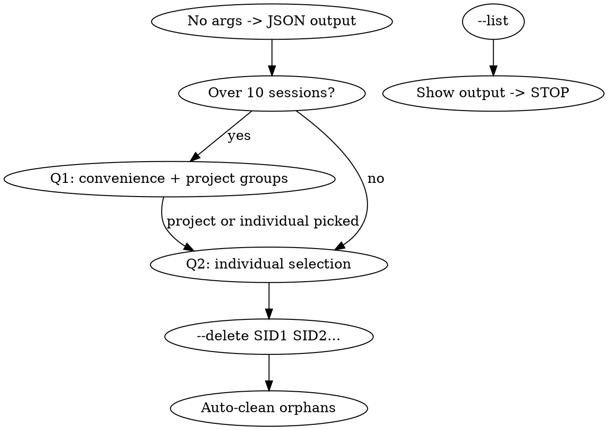

# Session Clean

Manage and clean up opencode sessions from database and storage.

## Quick Reference

| Mode | Command | Behavior |
|------|---------|----------|
| Interactive | `session-clean.py` | JSON output -> Question tool for selection |
| List | `session-clean.py --list` | Readable summary, then STOP |
| Delete | `session-clean.py --delete SID...` | Delete sessions + auto-clean orphans |
| Orphans | `session-clean.py --orphans` | Clean orphaned diff files only |
| Dry-run | `session-clean.py --dry-run --delete/orphans` | Preview without changes |

## Workflow

**Q1** (only when > 10 sessions): "Delete all" / "Delete all except current" for immediate action; project groups are **navigation only** → Q2; "Select individual sessions" → Q2.

**Q2** (`multiple: true`): label = `ses_short_id  title`, description = full session_id, message count, creation time. Paginate > 9 per group. Extra: "Delete all in this project" (when filtered) | "Back".

> **Q1 project selection is NAVIGATION only. NEVER delete from Q1 alone. Always show Q2 with individual options.**

## Other Modes

- **`--list`**: Display-only. STOP. Never proceed to deletion without user request.
- **`--delete SID...`**: Deletes from session + child tables (message, part, todo, session_message, session_share), then auto-cleans orphaned diff files.
- **`--orphans`**: Removes diff files for sessions no longer in DB.
- **`--dry-run`**: Preview before any destructive operation.

## Red Flags - STOP and Use Dry Run First

- Running delete without `--dry-run`
- Selecting a project group and assuming that deletes everything (Q1 is navigation only)
- Cleaning orphans without first previewing
- `--list` followed by proactive deletion without user request

## Notes

- Child records deleted before parent session (referential integrity)
- Orphan cleanup only removes files for missing sessions - always safe
- Paginate when > 10 sessions for Question tool compatibility