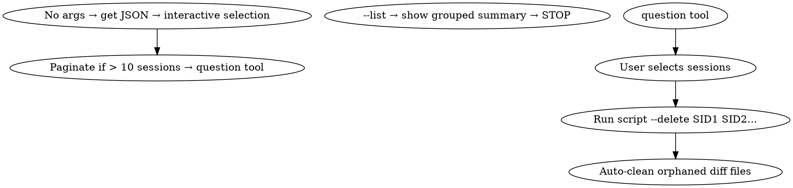

# Session Clean

Manage and clean up opencode sessions from the database and storage.

## When to Use

- User wants to list or delete opencode sessions
- User mentions "session cleanup", "delete session", "remove session", "session management"
- User wants to free space by removing old session data
- User asks about orphaned session diff files

## Core Workflow



## Implementation

### Mode 1: Interactive Selection (no arguments)

Run the script with no arguments to get all sessions as JSON:

```bash
python3 ~/.config/opencode/skills/session-clean/session-clean.py
```

Output is JSON grouped by project:

```json
{
  "projects": {
    "project_id_or_global": {
      "name": "...",
      "worktree": "...",
      "sessions": [
        {
          "session_id": "ses_xxx",
          "title": "...",
          "time_created": 1780295219079,
          "time_updated": 1780295219079,
          "message_count": 5,
          "part_count": 12
        }
      ]
    }
  },
  "total_sessions": 25
}
```

### Build Paginated Question Options

Parse the JSON output. Present sessions grouped by project, with each session as an individual selectable option.

**Question 1 — Convenience options + project groups:**

When total sessions > 10, start with a question offering convenience options and project groups:

Options (always include at top):
- "Delete all" — immediately deletes all session IDs (no further questions)
- "Delete all except current" — immediately deletes all session IDs except the current session (no further questions)
- Then list each project group: `[project_name] N sessions — first_session_title, ...`
  **⚠️ IMPORTANT: Selecting a project group is purely a NAVIGATION action — it filters Q2 to show sessions from that project only. NEVER execute deletion when a project group is selected. ALWAYS proceed to Question 2.**
- "Select individual sessions" — proceeds to Question 2 showing all sessions across all projects

When total sessions ≤ 10, skip directly to Question 2 format (show all sessions individually with convenience options at top).

**Question 2 — Individual session selection (per project or all):**

When user picked a project group or "Select individual sessions", show each session as a separate selectable option. 

**⚠️ CRITICAL: This is the ONLY step where individual sessions are selected for deletion. NEVER skip this step. NEVER delete sessions based on Question 1 selections alone (except for the explicit "Delete all" / "Delete all except current" convenience options).**

Each option `label` should be: `session_id_short  title` (e.g. `ses_17e0107  Opencode session cleanup`)
Each option `description` should include: full session_id, message count, creation time.

Set `multiple: true` on the question so the user can select one or more sessions.

Also include convenience options:
- "Delete all in this project" — deletes all session IDs in the current project filter (only shown when Q2 is filtered by a specific project)
- "Back" — return to Question 1

**Pagination rule:** The `question` tool supports at most ~10 options comfortably. If a project has > 9 sessions, paginate within that group (show first 9 + "Show more N sessions" option). "Show more" replaces the current page with the next batch.

When user selects sessions, proceed to delete them using `--delete`.

**Example flow:**

1. User runs session-clean → JSON output parsed
2. Question 1: "Delete all" / "Delete all except current" / "[DXS-1250-28/code] 13 sessions → view" / "[global] 8 sessions → view" / ... / "Select individual sessions"
3. User picks a project group → **navigate to Question 2** (showing sessions in that project, with `multiple: true`)
4. User selects specific sessions in Q2 → run `--delete SID1 SID2...`

**Anti-pattern to avoid:** When user selects a project group in Q1, do NOT collect all session IDs from that project and run `--delete`. You MUST show Q2 with individual session options first.

### Mode 2: List Only (--list)

```bash
python3 ~/.config/opencode/skills/session-clean/session-clean.py --list
```

This outputs a human-readable summary grouped by project. **Show the output to the user and STOP.** Do NOT proceed to interactive selection or deletion prompts unless the user explicitly asks.

### Mode 3: Delete Sessions

After the user selects sessions, run:

```bash
python3 ~/.config/opencode/skills/session-clean/session-clean.py --delete SID1 SID2...
```

This automatically:
1. **Deletes** all related data from tables: session, message, part, todo, session_message, session_share
2. **Cleans orphaned** session_diff files whose session ID no longer exists in DB

Use `--dry-run --delete SID1 SID2...` to preview what would be deleted without actually deleting.

### Mode 4: Clean Orphans Only

If you only want to clean orphaned diff files without deleting sessions:

```bash
python3 ~/.config/opencode/skills/session-clean/session-clean.py --orphans
```

## Important Notes

- `--list` is display-only; do not follow up with selection prompts unless the user requests it
- `--dry-run` can be combined with `--delete` or `--orphans` to preview changes
- Orphan cleanup only removes files for sessions that no longer exist in the database — always safe
- Deletion respects referential integrity: child records (messages, parts, todos) are deleted before parent sessions
- When sessions exceed 10, use pagination to avoid overwhelming the question tool